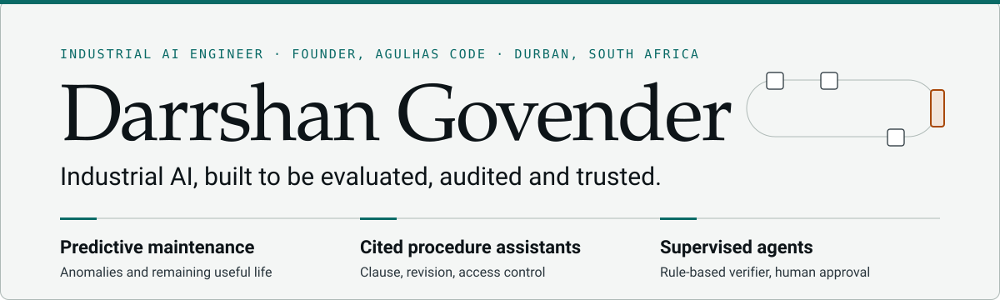
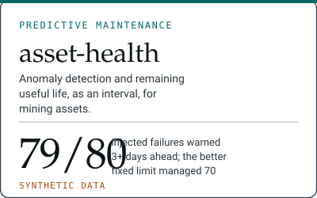
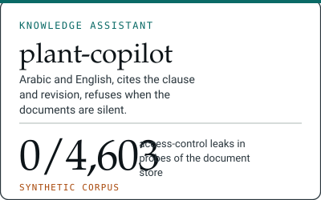
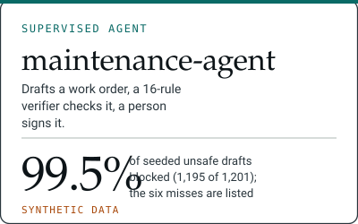
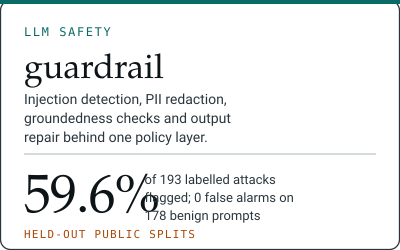
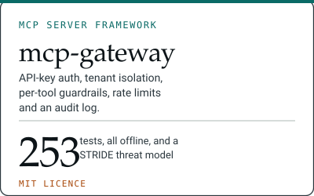
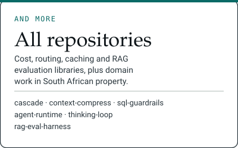
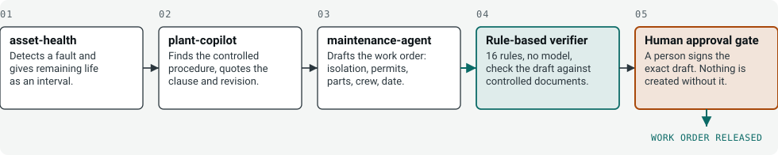
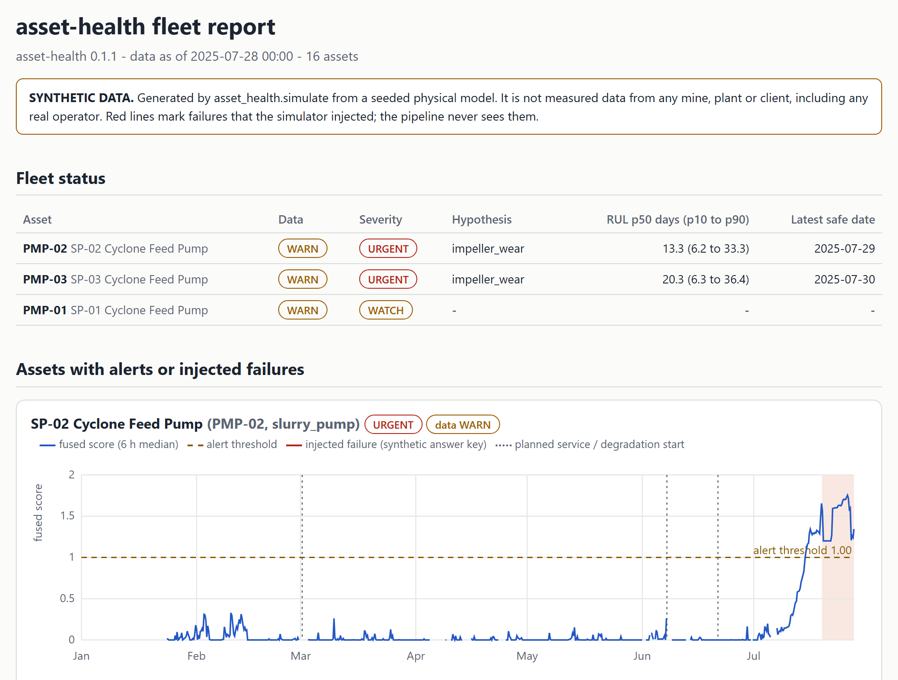

<a href="https://darrshangovender.github.io/"><picture><source media="(prefers-color-scheme: dark)" srcset="https://raw.githubusercontent.com/darrshangovender/darrshangovender/main/assets/banner-dark.svg"><source media="(prefers-color-scheme: light)" srcset="https://raw.githubusercontent.com/darrshangovender/darrshangovender/main/assets/banner-light.svg"></picture></a>

Industrial AI engineer and founder of Agulhas Code in Durban, South Africa: predictive maintenance, cited procedure assistants and human-supervised agents for heavy industry, each published with how it was tested and where it falls short.

**Available for contract and fractional work.** Durban (UTC+2), one hour behind Riyadh, so the working day overlaps almost entirely with Gulf hours. 
[Website](https://darrshangovender.github.io/) · [LinkedIn](https://www.linkedin.com/in/darrshangovender/) · [Agulhas Code](https://agulhascode.co.za) · darrshangovender@gmail.com

The featured repositories run offline by default with no API keys, state what their results were measured on, and list their limitations. Where the data is synthetic or the model is simulated, the README says so.

## Selected work

<a href="https://github.com/darrshangovender/asset-health"><picture><source media="(prefers-color-scheme: dark)" srcset="https://raw.githubusercontent.com/darrshangovender/darrshangovender/main/assets/card-asset-health-dark.svg"><source media="(prefers-color-scheme: light)" srcset="https://raw.githubusercontent.com/darrshangovender/darrshangovender/main/assets/card-asset-health-light.svg"></picture></a>
<a href="https://github.com/darrshangovender/plant-copilot"><picture><source media="(prefers-color-scheme: dark)" srcset="https://raw.githubusercontent.com/darrshangovender/darrshangovender/main/assets/card-plant-copilot-dark.svg"><source media="(prefers-color-scheme: light)" srcset="https://raw.githubusercontent.com/darrshangovender/darrshangovender/main/assets/card-plant-copilot-light.svg"></picture></a>
<a href="https://github.com/darrshangovender/maintenance-agent"><picture><source media="(prefers-color-scheme: dark)" srcset="https://raw.githubusercontent.com/darrshangovender/darrshangovender/main/assets/card-maintenance-agent-dark.svg"><source media="(prefers-color-scheme: light)" srcset="https://raw.githubusercontent.com/darrshangovender/darrshangovender/main/assets/card-maintenance-agent-light.svg"></picture></a>
<a href="https://github.com/darrshangovender/guardrail"><picture><source media="(prefers-color-scheme: dark)" srcset="https://raw.githubusercontent.com/darrshangovender/darrshangovender/main/assets/card-guardrail-dark.svg"><source media="(prefers-color-scheme: light)" srcset="https://raw.githubusercontent.com/darrshangovender/darrshangovender/main/assets/card-guardrail-light.svg"></picture></a>
<a href="https://github.com/darrshangovender/mcp-gateway"><picture><source media="(prefers-color-scheme: dark)" srcset="https://raw.githubusercontent.com/darrshangovender/darrshangovender/main/assets/card-mcp-gateway-dark.svg"><source media="(prefers-color-scheme: light)" srcset="https://raw.githubusercontent.com/darrshangovender/darrshangovender/main/assets/card-mcp-gateway-light.svg"></picture></a>
<a href="https://github.com/darrshangovender?tab=repositories"><picture><source media="(prefers-color-scheme: dark)" srcset="https://raw.githubusercontent.com/darrshangovender/darrshangovender/main/assets/card-more-dark.svg"><source media="(prefers-color-scheme: light)" srcset="https://raw.githubusercontent.com/darrshangovender/darrshangovender/main/assets/card-more-light.svg"></picture></a>

## The maintenance loop

<picture><source media="(prefers-color-scheme: dark)" srcset="https://raw.githubusercontent.com/darrshangovender/darrshangovender/main/assets/loop-dark.svg"><source media="(prefers-color-scheme: light)" srcset="https://raw.githubusercontent.com/darrshangovender/darrshangovender/main/assets/loop-light.svg"></picture>

A reference flow through three separate repositories, [asset-health](https://github.com/darrshangovender/asset-health), [plant-copilot](https://github.com/darrshangovender/plant-copilot) and [maintenance-agent](https://github.com/darrshangovender/maintenance-agent). They share no code, each runs on its own synthetic data, and maintenance-agent has not been run against the other two, so this is a design and not an integrated product. The [site](https://darrshangovender.github.io/) has architecture diagrams of each and two replays driven by the repositories' own output.

Top of asset-health's self-contained fleet report on its seeded synthetic fleet. The full report also shows the work order it drafts.

## Research harness

The harness runs a maintenance stack as one loop on a simulated plant, attacks it on held-out seeds under a pre-registration, and publishes its losses at the same size as its wins. Version 0.2 asks the same question of NASA's C-MAPSS turbofan trajectories, which are simulated, not field data.

- **[closed-loop](https://github.com/darrshangovender/closed-loop) (v0.1, synthetic data).** The shield behaved as its proof predicts: 0 violations of P1 to P3 in 500 episodes for each of two hostile proposers, against 306 of 500 and 150 of 150 with it off. The thesis did not hold where it was registered: closing the loop did not move pooled coverage outside the band of 0.03 (C-PERC.pooled, a loss). A second full run matched the first on 2,962 of the 2,967 records they share.
- **[closed-loop-v2](https://github.com/darrshangovender/closed-loop-v2) (v0.2, NASA C-MAPSS, simulated).** One full run, on 10 November 2026, after the freeze. V1, calibrated once, stayed inside the band when the loop closed: -0.0058 pooled over 373 evaluation units (interval -0.0255 to 0.0143), a loss for the thesis. V2L, which learns from the lives the policy ends, lost coverage: -0.0767 pooled (interval -0.0864 to -0.0670), a win for the thesis.

The limits are in each repository's own README: one author, simulated data, and a proof that covers a finite abstraction and safety, not progress.

## LLM infrastructure

Cost, safety and reliability controls that sit around a model.

| Repository | What it does | Key result |
|---|---|---|
| **[cascade](https://github.com/darrshangovender/cascade)** | Verifier-gated model cascade: answer with the cheapest model first, escalate only when verification fails, fit the thresholds offline. Benchmarked on a simulated model. | Counts every verifier call, priced from the list prices in the repo. On the simulated benchmark a 2-tier cascade is 5% cheaper at 99% of the strong model's accuracy; the 3-tier one costs more, and the README shows why. |
| **[context-compress](https://github.com/darrshangovender/context-compress)** | Prompt and RAG context compression with a fact-recall evaluator, so savings are reported next to what was lost. | On a synthetic RAG set: 48% fewer tokens with every fact kept, where naive truncation saves 57% but keeps 21.7%. |
| **[guardrail](https://github.com/darrshangovender/guardrail)** | Safety gateway for model inputs and outputs: prompt-injection detection, PII redaction, groundedness checks and structured-output repair behind one policy layer. | On the held-out test splits of two public datasets (whose training splits informed its patterns): 59.6% of 193 labelled attacks flagged, 0 false alarms on 178 benign prompts. Saudi National ID/Iqama, IBAN and mobile detection with checksums. |
| **[sql-guardrails](https://github.com/darrshangovender/sql-guardrails)** | Makes LLM-written SQL safe to execute: sqlglot AST allowlisting, read-only enforcement and optional EXPLAIN cost limits. Ships an adversarial corpus. | Executes only the guard's own normalised SQL, so a parser disagreement between guard and database cannot become a bypass. 22 functions blocked permanently, beyond the reach of config. |
| **[mcp-gateway](https://github.com/darrshangovender/mcp-gateway)** | MCP server wrapper with API-key auth, tenant isolation, per-tool guardrails, rate limits and an audit log. Serves the 2026-07-28 MCP revision and the 2025 revisions side by side. | STRIDE threat model; 253 tests |
| **[agent-runtime](https://github.com/darrshangovender/agent-runtime)** | Checkpointed state-machine executor for agents: resume after a crash, identical-call loop breaker, model fallback chain, schema self-correction. | Design reference; no headline number |
| **[thinking-loop](https://github.com/darrshangovender/thinking-loop)** | Published test-time reasoning strategies behind one interface, adjudicated by a critic, under hard token, time and cost budgets. | Benchmark harness; a real-model run needs your own key |
| **[rag-eval-harness](https://github.com/darrshangovender/rag-eval-harness)** | Faithfulness, answer relevance and recall@k for RAG pipelines, wired into CI so a regression fails the build. | A CI gate, not a benchmark |

## Domain work

- **[lease-abstract](https://github.com/darrshangovender/lease-abstract)**: South African residential lease abstraction with per-field clause citations and compliance checks against the Rental Housing Act and the Consumer Protection Act.
- **[affordability-scorer](https://github.com/darrshangovender/affordability-scorer)**: explainable tenant affordability scoring with tamper detection, calibration and structural fairness checks. No LLM in the scoring path.
- **[whatsapp-agent-kit](https://github.com/darrshangovender/whatsapp-agent-kit)**: WhatsApp Business agents with webhook dedup, the session window rule, human handoff and POPIA-aware redaction. Runs offline against a mock transport.

**Also:** [multi-agent-orchestrator](https://github.com/darrshangovender/multi-agent-orchestrator) · [rag-graph](https://github.com/darrshangovender/rag-graph) · [rag-chatbot](https://github.com/darrshangovender/rag-chatbot) · [doc-intelligence](https://github.com/darrshangovender/doc-intelligence) · [insightengine](https://github.com/darrshangovender/insightengine) · [agent-tool-router](https://github.com/darrshangovender/agent-tool-router) · [semantic-cache](https://github.com/darrshangovender/semantic-cache) · [llm-cost-tracker](https://github.com/darrshangovender/llm-cost-tracker) · [prompt-versioner](https://github.com/darrshangovender/prompt-versioner) · [prompt-eval-toolkit](https://github.com/darrshangovender/prompt-eval-toolkit) · [lead-scorer](https://github.com/darrshangovender/lead-scorer) · [churn-forecasting](https://github.com/darrshangovender/churn-forecasting) · [recommendation-engine](https://github.com/darrshangovender/recommendation-engine)

## How I work

- **Offline by default.** Tests, examples and benchmarks need no API keys and no network. Hosted-model paths are optional extras, so data can stay inside the client environment.
- **Every number has a script.** Results are regenerated by a script in the repository and say what they were measured on: synthetic data, a simulated model, or a bundled corpus.
- **Controls sit outside the model.** Rule-based verifiers, AST allowlists, access control before retrieval and human approval gates, not instructions in a prompt.
- **Limitations are written down.** Each README has a Limitations section that says what changes on real data.

## Contact

Available for contract and fractional work. I am in Durban (UTC+2), one hour behind Riyadh, so the working day overlaps almost entirely with Gulf hours.

[darrshangovender.github.io](https://darrshangovender.github.io/) · [LinkedIn](https://www.linkedin.com/in/darrshangovender/) · [agulhascode.co.za](https://agulhascode.co.za) · darrshangovender@gmail.com
